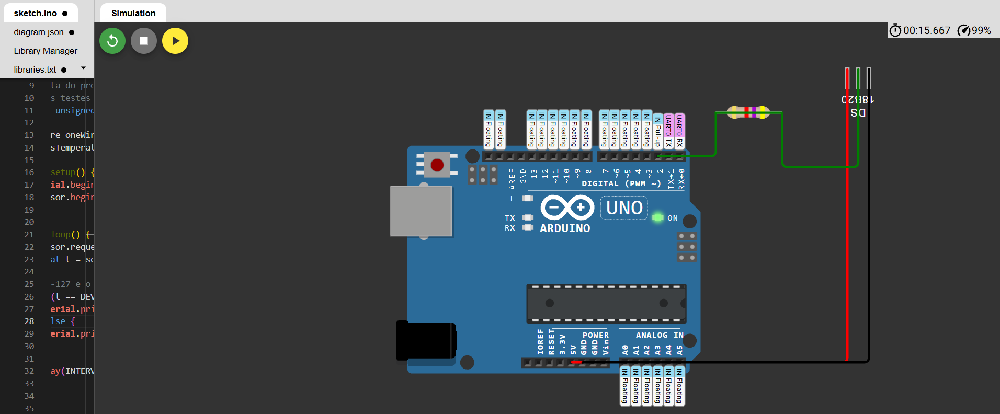
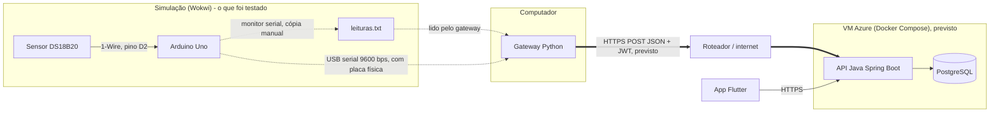
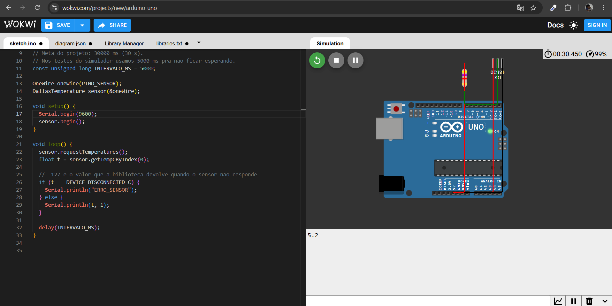
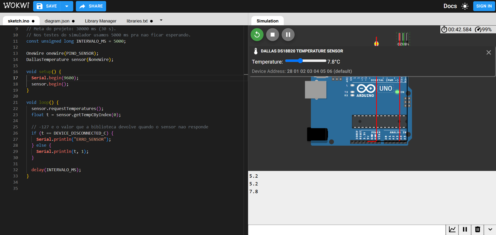
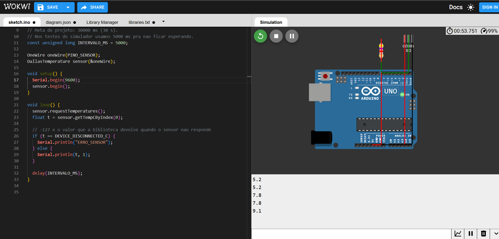
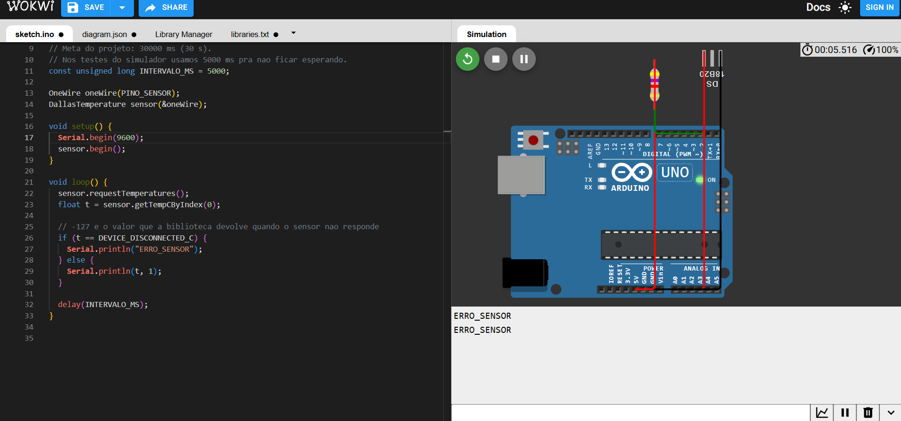
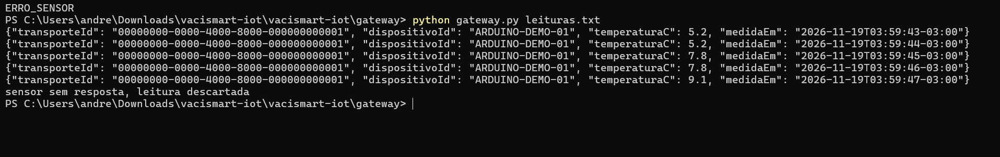

# VaciSmart – IoT

Parte de IoT e redes do projeto VaciSmart, desenvolvido para a Global Solution 2026/2 (CitizenTech).

O projeto consiste em um protótipo que monitora a temperatura de uma caixa térmica utilizada no transporte de vacinas e envia as leituras para a API do sistema. Nesta entrega, o protótipo foi simulado no Wokwi e a integração com a API foi demonstrada pelo formato do JSON, sem envio real para a Azure.

## Integrantes

| Nome | RM |
|---|---|
| Gabriel Deotti Zanatta | 567258 |
| Murilo Massini | 567383 |
| Giovanni Sacristan | 567548 |
| Caike Roberto de Souza Hollo | 568104 |
| Gianluca Kenis de Araujo | 566765 |

Turma: 2TDSPA

## O problema

As vacinas precisam ser armazenadas e transportadas em temperaturas adequadas para manter sua qualidade. Durante o transporte, alterações fora da faixa recomendada podem comprometer as doses.

Para ajudar a evitar esse problema, o VaciSmart propõe um sistema de monitoramento da temperatura da caixa térmica, permitindo acompanhar as condições durante o transporte e enviar os dados para a API do projeto.

## Objetivo da parte IoT

Desenvolver um protótipo capaz de realizar a leitura da temperatura por meio de um sensor, processar as informações e enviá-las ao sistema, permitindo acompanhar as condições de armazenamento das vacinas durante o transporte.

- ODS principal: 3 (Saúde e Bem-Estar)
- Conexões: ODS 9 e ODS 10

## O que o protótipo faz

A ideia é simples: um sensor mede a temperatura da caixa térmica, o Arduino lê esse valor e manda para a serial, e um programa em Python (o gateway) pega a leitura e envia para a API Java feita pelo Giovanni. É a API que decide se a leitura é normal, de atenção ou uma ocorrência. Essa parte é da matéria de Java, então aqui a gente só mede e envia.

Para a demonstração usamos uma vacina fictícia, a "Vacina Demo A", com faixa de 2,0 °C a 8,0 °C. Essa faixa vale só para o nosso cenário e não serve para vacinas de verdade.

| Leitura | Como a API classifica |
|---|---|
| de 3,0 a 7,0 °C | normal |
| de 2,0 a menos de 3,0 °C ou acima de 7,0 até 8,0 °C | atenção |
| abaixo de 2,0 °C ou acima de 8,0 °C | ocorrência |

## Sobre o simulador

Nenhum de nós tinha placa Arduino nem sensor em casa, então fizemos o protótipo no Wokwi. Perguntamos ao professor se podia e ele liberou, já que o objetivo é mostrar a ideia do trabalho.

Isso mudou algumas coisas no projeto:

- A temperatura não vem de uma caixa térmica de verdade. A gente muda o valor arrastando um controle deslizante do sensor, e esse controle não deixa escolher o número exato. Por isso nos testes saíram 5,2, 7,8 e 9,1 °C, e não os 5,2, 7,5 e 9,3 que tínhamos combinado no começo.
- O Wokwi não conecta numa porta USB do computador. Então copiamos as leituras do monitor serial para o arquivo `gateway/leituras.txt`, e o gateway lê dali. Com um Arduino físico, o gateway poderia ser adaptado para ler direto da porta serial (por exemplo, com a biblioteca `pyserial`).
- O código lê a temperatura a cada 5 segundos, só para os testes não demorarem. A ideia do projeto é 30 segundos. Para voltar a isso, é só mudar `INTERVALO_MS` para `30000` no código.

Link do projeto no Wokwi: https://wokwi.com/projects/481101348478034945

## Materiais

Tudo foi montado no simulador:

- Arduino Uno
- Sensor de temperatura DS18B20
- Resistor de 4,7 kΩ

## Ligação do circuito

O DS18B20 tem três pinos. Ligamos o VCC no 5V do Arduino, o GND no GND e o pino de dados (DQ) no pino digital 2. O resistor de 4,7 kΩ fica entre o pino de dados e o 5V e funciona como pull-up da linha de dados do 1-Wire.



## Como os dados chegam até o sistema (caminho projetado)



**Legenda:** a linha tracejada é o caminho usado na simulação (ou o alternativo com placa física). A linha grossa é a integração planejada, que não foi executada nos testes.

O Arduino Uno não tem rede e não envia HTTP sozinho. Quem fala com a rede é o gateway em Python, que lê a leitura, junta o ID do transporte, o ID do dispositivo e o horário (fuso -03:00) e faz um POST em JSON para a API Java. A API guarda a leitura no banco, e o app Flutter consulta a API.

### Componentes e meios de comunicação

| Etapa | Origem → Destino | Meio / protocolo | Componente |
|---|---|---|---|
| 1 | Sensor DS18B20 → Arduino Uno | 1-Wire (pino digital 2) | Resistor pull-up de 4,7 kΩ entre dados e 5V |
| 2 | Arduino Uno → Computador | Serial (UART) via USB, 9600 bps | Cabo USB (no Wokwi: monitor serial + `leituras.txt`) |
| 3 | Gateway Python → API Java | HTTPS, POST com JSON e JWT Bearer | Computador, roteador e internet |
| 4 | API Java → Banco | Rede interna do Docker Compose | VM Azure com containers (previsto) |
| 5 | App Flutter → API Java | HTTPS, JWT | Celular ou emulador |

Escolhemos serial mais gateway por ser a forma mais simples de montar e testar, sem precisar de um módulo Wi-Fi.

O projeto não usa GPS nem localização do transporte, foi uma decisão de escopo do grupo.

O JSON que o gateway monta segue o contrato da API do Giovanni, e é enviado para `POST /api/v1/transportes/{transporteId}/leituras`:

```json
{
  "transporteId": "00000000-0000-4000-8000-000000000001",
  "dispositivoId": "ARDUINO-DEMO-01",
  "temperaturaC": 5.2,
  "medidaEm": "2026-11-10T14:20:30-03:00"
}
```

## Como rodar

### 1. Arduino no Wokwi

1. Entre em wokwi.com e crie um projeto Arduino Uno.
2. Cole o código de `arduino/leitura_temperatura.ino` na aba `sketch.ino` e o de `arduino/diagram.json` na aba `diagram.json`.
3. Adicione as bibliotecas `OneWire` e `DallasTemperature` pelo Library Manager (ou cole `arduino/libraries.txt` na aba `libraries.txt`).
4. Rode a simulação e clique no sensor para mudar a temperatura. O valor aparece no monitor serial.

### 2. Gateway

Precisa de Python 3 instalado. Dentro da pasta `gateway`:

```bash
pip install -r requirements.txt
python gateway.py leituras.txt
```

Assim, sem configurar nada, o gateway só lê o `leituras.txt` e mostra na tela o JSON de cada leitura. Foi como rodamos nos testes.

Para mandar de verdade para a API, o gateway usa duas variáveis de ambiente. No PowerShell:

```powershell
$env:API_URL = "https://URL-DA-API/api/v1/transportes/ID/leituras"
$env:API_TOKEN = "jwt-da-api"
python gateway.py leituras.txt
```

A API usa JWT Bearer, não uma chave fixa. O gateway manda o token no cabeçalho `Authorization: Bearer ...`.

No Linux ou Mac, troque por `export API_URL="..."` e `export API_TOKEN="..."`. O token não fica em nenhum arquivo do repositório. O `.env.example` só mostra quais variáveis existem.

## Testes

Rodamos quatro cenários no Wokwi e tiramos print do monitor serial de cada um. Os prints estão em `docs/evidencias/`.

| # | Cenário | O que fizemos | O que apareceu | Print |
|---|---|---|---|---|
| 1 | Normal | Deixamos o sensor em 5,2 °C | O monitor mostrou `5.2` | `teste1_normal.png` |
| 2 | Atenção | Arrastamos o controle até ficar acima de 7 °C | O monitor mostrou `7.8` | `teste2_atencao.png` |
| 3 | Fora da faixa | Arrastamos até passar de 8 °C | O monitor mostrou `9.1` | `teste3_ocorrencia.png` |
| 4 | Sensor desconectado | Tiramos o fio de dados do pino 2 | O monitor mostrou `ERRO_SENSOR` | `teste4_sensor.png` |

Os valores 7,8 e 9,1 não são os que tínhamos planejado (7,5 e 9,3), porque o controle do sensor no Wokwi pula um pouco e não deixa escolher o número exato. Mesmo assim, cada valor caiu na faixa que queríamos testar.

Depois copiamos essas leituras para o `gateway/leituras.txt` e rodamos o gateway. Ele mostrou um JSON para cada temperatura e ignorou a linha `ERRO_SENSOR`, como esperado (print em `docs/evidencias/gateway.png`).

Quando o sensor falha, o gateway não envia nada. Na regra do projeto (RN05), se a API ficar mais de 3 minutos sem leitura, ela cria o evento `PERDA_DE_TELEMETRIA`.

A classificação em normal, atenção e ocorrência é feita pela API Java, não pelo Arduino. Aqui só testamos a medição, o envio e o formato do dado.











### Métricas dos testes

| Métrica | Resultado |
|---|---|
| Cenários testados | 4 (normal, atenção, fora da faixa, sensor desconectado) |
| Intervalo entre leituras | 5 s nos testes (alvo do projeto: 30 s) |
| Leituras válidas processadas pelo gateway | 5 |
| JSONs gerados | 5 |
| Linhas `ERRO_SENSOR` ignoradas | 1 |
| Leituras enviadas à API | 0 (integração apenas simulada) |

## Limitações

- Tudo foi feito em simulador. Não usamos sensor físico, então não tem calibração nem teste com uma caixa térmica real.
- O DS18B20 real tem margem de erro (cerca de ±0,5 °C), o que importa perto dos limites de 2,0 e 8,0 °C. No Wokwi o sensor é ideal.
- Não conectamos o gateway na API da Azure. A integração foi só simulada, como combinamos com o Giovanni. O gateway monta o JSON no formato da API e já tem o envio com autenticação JWT pronto, mas nos testes ele só mostra o JSON na tela.
- O Arduino não tem relógio, então o horário (`medidaEm`) é colocado pelo gateway quando ele processa a linha, e não no momento exato da medição.
- O gateway precisa de um computador ligado. Se a API estiver fora do ar, ele não guarda as leituras para reenviar depois.
- No simulador, as leituras passam por um arquivo de texto. Com um Arduino de verdade, o gateway precisaria ser adaptado para ler da porta serial.
- Os limites de temperatura são só do cenário de demonstração. Isso não é um sistema clínico validado.
- Não tem GPS nem localização do transporte, foi decisão do grupo.

## Por que fizemos assim

Usamos o DS18B20 porque é um sensor digital de temperatura, serve para a faixa de 2 a 8 °C e liga com um fio de dados só. Como o Arduino Uno não tem rede, usamos o computador como ponte (o gateway) em vez de comprar um módulo Wi-Fi, que era mais caro e mais difícil de testar. O Wokwi entrou porque não tínhamos placa nem sensor, e ele deixa mudar a temperatura na hora. E o JSON é o mesmo que combinamos com o Giovanni, para o dado chegar na API sem precisar de conversão.

