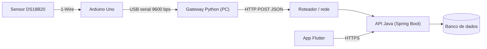

# VaciSmart – IoT

Parte de IoT e redes do projeto **VaciSmart**, desenvolvido para a Global Solution 2026/2 (CitizenTech).

O projeto consiste em um protótipo que monitora a temperatura de uma caixa térmica utilizada no transporte de vacinas e envia as leituras para a API do sistema.

## Integrantes

| Nome | RM |
|---|---|
| Gabriel Deotti Zanatta | 567258 |
| Murilo Massini | 567383 |
| Giovanni Sacristan | 567548 |
| Caike Roberto de Souza Hollo | 568104 |
| Gianluca Kenis de Araujo | 566765 |

**Turma:** 2TDSPA

## O problema

As vacinas precisam ser armazenadas e transportadas em temperaturas adequadas para manter sua qualidade. Durante o transporte, alterações fora da faixa recomendada podem comprometer as doses.

Para ajudar a evitar esse problema, o VaciSmart propõe um sistema de monitoramento da temperatura da caixa térmica, permitindo acompanhar as condições durante o transporte e enviar os dados para a API do projeto.

## Objetivo da parte IoT

Desenvolver um protótipo capaz de realizar a leitura da temperatura por meio de um sensor, processar as informações e enviá-las ao sistema, permitindo acompanhar as condições de armazenamento das vacinas durante o transporte.

- ODS principal: 3 (Saúde e Bem-Estar)
- Conexões: ODS 9 e ODS 10

## O que o protótipo faz

A ideia é simples: um sensor mede a temperatura da caixa térmica, o Arduino lê esse valor e manda para a serial, e um programa em Python (o gateway) pega a leitura e envia para a API Java feita pelo Giovanni. É a API que decide se a leitura é normal, de atenção ou uma ocorrência. Essa parte é da matéria de Java, então aqui a gente só mede e envia.

Para a demonstração usamos uma vacina fictícia, a "Vacina Demo A", com faixa de 2,0 °C a 8,0 °C. Essa faixa vale só para o nosso cenário e não serve para vacinas de verdade.

| Leitura | Como a API classifica |
|---|---|
| de 3,0 a 7,0 °C | normal |
| de 2,0 a 3,0 °C ou de 7,0 a 8,0 °C | atenção |
| abaixo de 2,0 °C ou acima de 8,0 °C | ocorrência |

## Sobre o simulador

Nenhum de nós tinha placa Arduino nem sensor em casa, então fizemos o protótipo no Wokwi. Perguntamos ao professor se podia e ele liberou, já que o objetivo é mostrar a ideia do trabalho.

Isso mudou algumas coisas no projeto:

- A temperatura não vem de uma caixa térmica de verdade. A gente muda o valor arrastando um controle deslizante do sensor, e esse controle não deixa escolher o número exato. Por isso nos testes saíram 5,2, 7,8 e 9,1 °C, e não os 5,2, 7,5 e 9,3 que tínhamos combinado no começo.
- O Wokwi não conecta numa porta USB do computador. Então copiamos as leituras do monitor serial para o arquivo `gateway/leituras.txt`, e o gateway lê dali. Com um Arduino físico ele leria direto da porta serial, usando a biblioteca `pyserial`.
- O código lê a temperatura a cada 5 segundos, só para os testes não demorarem. A ideia do projeto é 30 segundos. Para voltar a isso, é só mudar `INTERVALO_MS` para `30000` no código.

Link do projeto no Wokwi: https://wokwi.com/projects/481101348478034945

## Materiais

Tudo foi montado no simulador:

- Arduino Uno
- Sensor de temperatura DS18B20
- Resistor de 4,7 kΩ

## Ligação do circuito

O DS18B20 tem três pinos. Ligamos o VCC no 5V do Arduino, o GND no GND e o pino de dados (DQ) no pino digital 2. O resistor de 4,7 kΩ fica entre o pino de dados e o 5V, e serve para o sensor funcionar direito.

Print do circuito: `docs/circuito.png` (ainda vou subir a paasta docs pois falta um print)

## Como os dados chegam até o sistema



O caminho é este: o sensor fala com o Arduino pelo protocolo 1-Wire, e o Arduino manda o valor pela USB (serial a 9600 bps) para o computador. No computador, o gateway em Python lê o valor, junta com o ID do transporte, o ID do dispositivo e o horário (fuso -03:00) e faz um POST em JSON. Esse POST passa pela rede até a API Java, que guarda a leitura no banco. O app em Flutter consulta a API.

O Arduino Uno não manda HTTP sozinho, porque não tem rede. Quem fala com a rede é o gateway. Escolhemos serial mais gateway por ser a forma mais simples de montar e testar, e por não precisar comprar um módulo Wi-Fi.

O projeto não usa GPS nem localização do transporte, foi uma decisão de escopo do grupo.

O JSON que o gateway monta é o que combinamos com o Giovanni:

```json
{
  "transporteId": "00000000-0000-4000-8000-000000000001",
  "dispositivoId": "ARDUINO-DEMO-01",
  "temperaturaC": 5.2,
  "medidaEm": "2026-11-10T14:20:30-03:00"
}
```

## Como rodar

**Arduino no Wokwi**

1. Entre em wokwi.com e crie um projeto Arduino Uno.
2. Cole o código de `arduino/leitura_temperatura.ino` na aba `sketch.ino` e o de `arduino/diagram.json` na aba `diagram.json`.
3. Adicione as bibliotecas `OneWire` e `DallasTemperature` pelo Library Manager (ou cole `arduino/libraries.txt` na aba `libraries.txt`).
4. Rode a simulação e clique no sensor para mudar a temperatura. O valor aparece no monitor serial.
